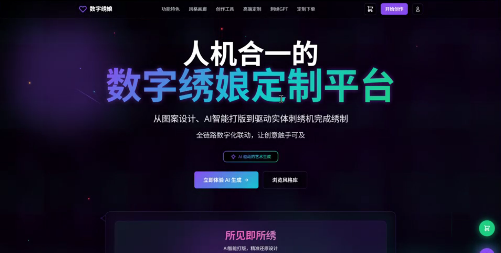
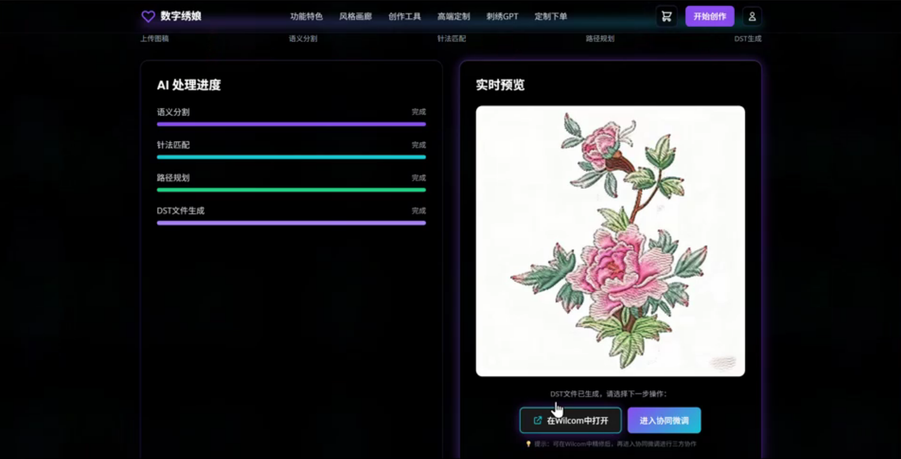

# 数字绣娘——AI驱动的刺绣个性化柔性定制与产业生态平台

> 融合人工智能图像处理、智能刺绣设计与柔性定制服务，推动传统刺绣工艺与数字技术深度融合。

[](https://spring.io/projects/spring-boot)
[](https://vuejs.org/)
[](https://www.python.org/)


## 项目展示

数字绣娘是一款面向刺绣个性化定制场景的AI智能设计与服务平台。

系统采用 Vue 3、Spring Boot 和 Python AI 服务架构，支持图像上传、AI刺绣效果生成、个性化定制、智能报价及订单管理等功能。

### 系统界面



### AI刺绣效果展示



## 核心技术

- **AI刺绣图像处理**：基于PyTorch与AttenEmbGAN模型，实现图像的刺绣风格效果生成。
- **智能定制服务**：支持图片、文字等个性化定制需求。
- **智能报价与订单管理**：结合设计复杂度、材料等因素进行报价和订单管理。
- **前后端协同架构**：基于Vue 3、Spring Boot、Flask构建完整的业务与AI服务链路。

## 系统运行演示

演示视频：尚待上传。完成真实系统录屏后，请在此处添加可公开访问的视频链接。

## 安装与部署

本项目支持Docker Compose部署。

详细部署步骤请参阅：
[DEPLOY.md](DEPLOY.md)

## 代码说明

- `frontend/`：前端页面与交互功能
- `backend/`：后端业务服务
- `code/`：Python AI算法与推理服务
- `deploy/`：部署相关文件

## 项目简介

刺绣定制系统是一个现代化的全栈 Web 应用，致力于为用户提供便捷的刺绣定制服务。系统集成了 AI 图像处理技术，能够将用户上传的图片转换为刺绣图案，支持多种刺绣风格（苏绣、湘绣、蜀绣、粤绣）和材质选择。

### 核心特性

- **AI 图像处理**：基于 PyTorch 的深度学习模型，自动将图片转换为刺绣效果图
- **智能定价引擎**：根据针法数量、颜色复杂度、面料材质等自动计算价格
- **灵活定制**：支持图片定制和文字定制两种模式
- **订单管理**：完整的订单流程管理（11 种状态流转）
- **云端存储**：集成阿里云 OSS，支持图片上传和 CDN 加速
- **实时计算**：前端实时展示价格明细和优惠信息

## 技术架构

### 系统架构

```
┌─────────────────┐
│   Vue 3 前端     │  (Element Plus UI)
└────────┬────────┘
         │ HTTP/REST
┌────────▼────────┐
│  Spring Boot    │  (JWT 认证 + Redis 缓存)
│   后端服务       │
└────┬───┬───┬────┘
     │   │   │
     │   │   └──────► Aliyun OSS (文件存储)
     │   │
     │   └──────────► Redis (缓存 + Session)
     │
     └──────────────► MySQL (业务数据)

┌─────────────────┐
│  Python Flask   │  (AI 图像处理服务)
│   AI 服务        │
└─────────────────┘
     PyTorch + GAN
```

### 技术栈

#### 后端 (Backend)

- **框架**：Spring Boot 3.5.6
- **安全**：Spring Security + JWT (JJWT 0.12.3)
- **数据库**：MySQL 8.0+ + MyBatis-Plus 3.5.5
- **缓存**：Redis 7.x + Redisson 3.25.2
- **存储**：阿里云 OSS 3.17.4
- **迁移**：Flyway (版本化数据库管理)
- **文档**：SpringDoc OpenAPI 2.7.0 + Swagger UI
- **工具**：Lombok, Hutool 5.8.24, Fastjson2

#### 前端 (Frontend)

- **框架**：Vue 3.5.22 + Vue Router 4.5.1
- **状态管理**：Pinia 3.0.3
- **UI 组件**：Element Plus 2.11.4
- **构建工具**：Vite 7.1.7
- **HTTP 客户端**：Axios 1.12.2
- **样式预处理**：Sass 1.93.2

#### AI 服务 (AI Service)

- **深度学习**：PyTorch + AttenEmbGAN 模型
- **Web 框架**：Flask 2.3.2 + Flask-CORS
- **图像处理**：Pillow 9.5.0
- **科学计算**：NumPy, SciPy

## 项目结构

```
cixiu/
├── backend/                 # Spring Boot 后端服务
│   ├── src/
│   │   ├── main/
│   │   │   ├── java/com/jinyue/cixiu/
│   │   │   │   ├── common/         # 通用模块
│   │   │   │   │   ├── config/     # 配置类 (10 个)
│   │   │   │   │   ├── filter/     # JWT 认证过滤器
│   │   │   │   │   ├── exception/  # 异常处理
│   │   │   │   │   └── utils/      # 工具类
│   │   │   │   └── module/         # 业务模块
│   │   │   │       ├── auth/       # 认证模块
│   │   │   │       ├── user/       # 用户管理
│   │   │   │       ├── customize/  # 定制订单
│   │   │   │       └── order/      # 订单管理
│   │   │   └── resources/
│   │   │       ├── application.yml          # 主配置
│   │   │       ├── application-dev.yml      # 开发环境
│   │   │       ├── application-prod.yml     # 生产环境
│   │   │       └── db/migration/            # Flyway 数据库迁移
│   ├── pom.xml
│   ├── README.md            # 后端详细文档
│   └── QUICKSTART.md        # 快速开始指南
│
├── frontend/                # Vue 3 前端应用
│   ├── src/
│   │   ├── api/             # API 请求封装
│   │   ├── components/      # Vue 组件
│   │   ├── router/          # 路由配置
│   │   ├── store/           # Pinia 状态管理
│   │   ├── views/           # 页面组件
│   │   └── utils/           # 工具函数
│   ├── package.json
│   ├── vite.config.ts
│   ├── .env.development     # 开发环境变量
│   ├── .env.production      # 生产环境变量
│   ├── README.md            # 前端文档
│   └── INTEGRATION_GUIDE.md # 前端集成指南
│
├── code/                    # Python AI 服务
│   ├── api_server.py        # Flask API 服务器
│   ├── train.py             # 模型训练脚本
│   ├── test_api.py          # API 测试脚本
│   ├── cleanup_old_results.py  # 清理旧文件
│   ├── models/              # AI 模型定义
│   │   └── AttenEmbGAN_model.py
│   ├── checkpoints/         # 预训练模型权重
│   ├── data/                # 数据处理
│   ├── requirements_api.txt # Python 依赖
│   └── README_API.md        # AI 服务 API 文档
│
└── docs/                    # 项目文档
    └── images/              # 项目展示截图
```

## 功能模块

### 已完成功能 ✅

#### 1. 用户认证模块
- 手机号/邮箱注册
- 密码登录 / 验证码登录
- JWT Token 管理
- Token 自动刷新
- 安全登出

#### 2. 用户管理模块
- 个人信息查看/编辑
- 收货地址管理 (CRUD)
- 默认地址设置
- 历史订单查询

#### 3. 文件存储模块
- 图片上传（定制图片）
- 头像上传
- 设计文件上传
- 阿里云 OSS 集成
- CDN 加速访问

#### 4. 定制订单模块
- 刺绣风格选择（苏绣、湘绣、蜀绣、粤绣）
- 面料类型选择
- 线材材质选择
- 图片定制工作流
- 文字定制工作流
- 实时价格计算

#### 5. 智能定价引擎
- **算法公式**：基础价格 + 针法费用 + 颜色费用 + 面料费用 + 线材费用
- 加急订单加价（1.5 倍）
- 数量折扣计算
- 价格明细展示

#### 6. 订单管理模块
- 订单列表（支持状态筛选）
- 订单详情查询
- 11 种订单状态流转
- 订单取消（待支付状态）

### 待开发功能 🔄

- [ ] 设计师管理后台
- [ ] 支付网关集成（支付宝/微信）
- [ ] WebSocket 实时通知
- [ ] 模板市场
- [ ] 生产进度追踪
- [ ] 售后管理系统
- [ ] 短信/邮件服务

## 快速开始

### 环境要求

- **Java**：JDK 17+
- **Node.js**：16+
- **Python**：3.8+
- **MySQL**：8.0+
- **Redis**：7.x
- **Maven**：3.6+

### 一、后端服务启动

```bash
# 1. 进入后端目录
cd backend

# 2. 配置数据库
# 创建数据库：CREATE DATABASE cixiu CHARACTER SET utf8mb4 COLLATE utf8mb4_unicode_ci;
# 修改 application-dev.yml 中的数据库连接信息

# 3. 配置 Redis
# 确保 Redis 服务正在运行：redis-server

# 4. 配置阿里云 OSS
# 在 application-dev.yml 中填写 OSS 配置
# 详见: backend/docs/阿里云OSS配置说明.md

# 5. 启动应用（Flyway 会自动执行数据库迁移）
mvn clean spring-boot:run

# 6. 访问 API 文档
# Knife4j: http://localhost:8080/doc.html
# Swagger UI: http://localhost:8080/swagger-ui.html
```

### 二、前端服务启动

```bash
# 1. 进入前端目录
cd frontend

# 2. 安装依赖
npm install

# 3. 启动开发服务器
npm run dev

# 4. 访问应用
# 浏览器打开: http://localhost:3000
```

### 三、AI 服务启动

```bash
# 1. 进入 AI 服务目录
cd code

# 2. 安装依赖
pip install -r requirements_api.txt

# 3. 下载预训练模型
# 确保 checkpoints/AttnEmbGAN_st_10/ 目录存在模型文件

# 4. 启动 Flask 服务
python api_server.py

# 5. 测试 API
python test_api.py
```

### 完整启动顺序

```bash
# 终端 1: 启动 Redis
redis-server

# 终端 2: 启动 MySQL
# (根据你的操作系统启动 MySQL 服务)

# 终端 3: 启动后端
cd backend && mvn clean spring-boot:run

# 终端 4: 启动 AI 服务
cd code && python api_server.py

# 终端 5: 启动前端
cd frontend && npm run dev
```

## 核心 API 端点

### 认证相关

```
POST   /api/auth/register         # 用户注册
POST   /api/auth/login            # 密码登录
POST   /api/auth/login/code       # 验证码登录
POST   /api/auth/refresh          # 刷新 Token
POST   /api/auth/logout           # 退出登录
```

### 用户管理

```
GET    /api/user/profile          # 获取个人信息
PUT    /api/user/profile          # 更新个人信息
GET    /api/user/addresses        # 获取收货地址列表
POST   /api/user/addresses        # 新增收货地址
PUT    /api/user/addresses/{id}   # 更新收货地址
DELETE /api/user/addresses/{id}   # 删除收货地址
```

### 定制订单

```
POST   /api/customize/order       # 提交定制订单
POST   /api/customize/price       # 计算价格
GET    /api/customize/styles      # 获取刺绣风格列表
GET    /api/customize/fabrics     # 获取面料类型列表
GET    /api/customize/threads     # 获取线材列表
```

### 订单管理

```
GET    /api/orders                # 获取订单列表
GET    /api/orders/{id}           # 获取订单详情
GET    /api/orders/no/{orderNo}   # 根据订单号查询
PUT    /api/orders/{id}/cancel    # 取消订单
```

### 文件上传

```
POST   /api/common/upload/image   # 上传图片
POST   /api/common/upload/avatar  # 上传头像
POST   /api/common/upload/design  # 上传设计文件
```

详细 API 文档请访问：http://localhost:8080/doc.html

## 数据库设计

系统采用 Flyway 进行版本化的数据库迁移管理：

- **V1__init_schema.sql**: 初始化数据库结构
  - 用户表 (users)
  - 收货地址表 (user_addresses)
  - 订单表 (orders)
  - 订单详情表 (order_details)

- **V2__add_price_details_to_orders.sql**: 添加价格明细字段
- **V3__add_result_image_to_order_detail.sql**: 添加 AI 生成结果图
- **V4__add_text_customize_fields.sql**: 添加文字定制字段

### 核心表结构

```sql
-- 用户表
users (id, username, phone, email, password, avatar, created_at, updated_at)

-- 收货地址表
user_addresses (id, user_id, receiver_name, phone, province, city, district,
                detail_address, is_default, created_at, updated_at)

-- 订单表
orders (id, order_no, user_id, total_price, status, payment_method,
        created_at, updated_at)

-- 订单详情表
order_details (id, order_id, embroidery_style, fabric_type, thread_type,
               original_image, result_image, quantity, unit_price, total_price)
```

## 配置说明

### 后端配置

配置文件位于 `backend/src/main/resources/`:

```yaml
# application.yml - 主配置
spring:
  profiles:
    active: dev  # 激活环境：dev 或 prod

# application-dev.yml - 开发环境
spring:
  datasource:
    url: jdbc:mysql://localhost:3306/cixiu
    username: root
    password: your_password
  data:
    redis:
      host: localhost
      port: 6379

aliyun:
  oss:
    endpoint: oss-cn-beijing.aliyuncs.com
    bucket-name: your-bucket-name
    access-key-id: your-access-key
    access-key-secret: your-secret-key

ai:
  service:
    url: http://localhost:8001
```

### 前端配置

环境变量文件：

```bash
# .env.development
VITE_APP_BASE_API=http://localhost:8080

# .env.production
VITE_APP_BASE_API=https://your-production-api.com
```

### AI 服务配置

在 `code/api_server.py` 中修改：

```python
# 服务端口
app.run(host='0.0.0.0', port=8001, debug=True)

# 模型路径
CHECKPOINT_DIR = './checkpoints/AttnEmbGAN_st_10/'
```

## 部署指南

### Docker 部署（推荐）

```bash
# 构建后端镜像
cd backend
docker build -t cixiu-backend:latest .

# 构建前端镜像
cd frontend
docker build -t cixiu-frontend:latest .

# 使用 Docker Compose 启动所有服务
docker-compose up -d
```

### 生产环境部署检查清单

- [ ] 修改 `application-prod.yml` 中的数据库连接
- [ ] 配置生产环境的 Redis 连接
- [ ] 配置阿里云 OSS 生产环境凭证
- [ ] 修改前端 `.env.production` 中的 API 地址
- [ ] 关闭 Swagger 文档（`springdoc.api-docs.enabled=false`）
- [ ] 配置日志输出到文件
- [ ] 设置 JVM 参数：`-Xms2g -Xmx2g`
- [ ] 配置 Nginx 反向代理
- [ ] 启用 HTTPS 证书
- [ ] 配置跨域策略
- [ ] 设置文件上传大小限制

## 开发指南

### 后端开发

```bash
# 运行测试
mvn test

# 打包应用
mvn clean package -Dmaven.test.skip=true

# 生成 JAR 文件
# target/cixiu-backend-0.0.1-SNAPSHOT.jar
```

### 前端开发

```bash
# 安装依赖
npm install

# 开发模式
npm run dev

# 生产构建
npm run build

# 预览构建结果
npm run preview
```

### 代码规范

- **Java**：遵循阿里巴巴 Java 开发手册
- **JavaScript/Vue**：遵循 Vue 官方风格指南
- **Python**：遵循 PEP 8 规范

## 常见问题

### 1. 数据库连接失败

```
Error: Unable to connect to database
```

**解决方案**：
- 检查 MySQL 服务是否启动
- 确认 `application-dev.yml` 中的用户名密码正确
- 确认数据库 `cixiu` 已创建

### 2. Redis 连接失败

```
Error: Could not connect to Redis
```

**解决方案**：
- 启动 Redis：`redis-server`
- 检查端口 6379 是否被占用

### 3. 文件上传失败

```
Error: Upload failed
```

**解决方案**：
- 检查阿里云 OSS 配置是否正确
- 确认 OSS Bucket 权限设置
- 查看 `backend/docs/阿里云OSS配置说明.md`

### 4. AI 服务调用失败

```
Error: AI service unavailable
```

**解决方案**：
- 确认 Python Flask 服务已启动（端口 8001）
- 检查模型文件是否存在于 `checkpoints/` 目录
- 查看 AI 服务日志

## 文档资源

- [后端详细文档](backend/README.md)
- [前端开发指南](frontend/README.md)
- [后端快速开始](backend/QUICKSTART.md)
- [前端快速开始](frontend/README.md)
- [AI 服务 API](code/README_API.md)
- [AI 集成指南](frontend/INTEGRATION_GUIDE.md)
- [系统开发文档](backend/docs/刺绣定制系统开发文档.md)
- [阿里云 OSS 配置](backend/docs/阿里云OSS配置说明.md)

## 版本历史

### v1.1 (2025-10-24)
- 新增文字定制功能
- 优化前端用户体验
- 添加创建时间和更新时间字段
- 优化 AI 服务调用逻辑
- 新增异步清理旧文件功能

### v1.0 (2025-10-11)
- 完成用户认证系统
- 实现订单管理功能
- 集成阿里云 OSS 存储
- 实现智能定价引擎
- 完成 AI 图像处理集成

## 贡献指南

欢迎提交 Issue 和 Pull Request！

1. Fork 本仓库
2. 创建特性分支：`git checkout -b feature/your-feature`
3. 提交更改：`git commit -m 'Add some feature'`
4. 推送分支：`git push origin feature/your-feature`
5. 提交 Pull Request

### 开发分支说明

- `master`: 主分支（生产环境）
- `feature-dev-*`: 功能开发分支

## 许可证

本项目包含自主研发代码、第三方依赖、AI模型及相关数据资源。各部分的使用与授权范围正在核实，暂不统一声明采用MIT等开源许可证。

## 联系方式

- 项目地址：[GitHub Repository](https://github.com/Xie681/cixui)
- 问题反馈：[Issues](https://github.com/Xie681/cixui/issues)

---

**⚠️ 注意事项**

1. 本项目仅供学习和研究使用
2. 生产环境部署前请修改所有默认密码和密钥
3. 请遵守相关法律法规，合理使用 AI 技术
4. 建议定期备份数据库数据

**🎨 享受你的刺绣定制之旅！**
